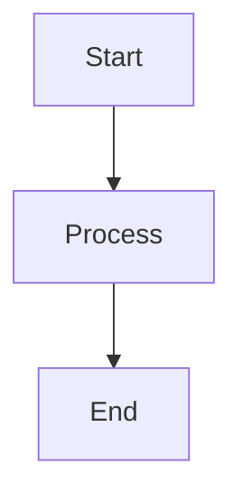

# Markdown API Documentation

<div align="center">
  
  <h1>Markdown Syntax Utilities API</h1>
  <p>Comprehensive guide to Markdown formatting and syntax</p>
</div>

## Overview

The Markdown API provides a complete reference for Markdown syntax and formatting options, specifically optimized for GitHub README files and documentation. This utility covers everything from basic text formatting to advanced HTML integration.

**Source:** [`utils/markdown/sintaxes_marcacao.md`](../utils/markdown/sintaxes_marcacao.md)  
**Compatibility:** GitHub Flavored Markdown (GFM)  
**HTML Integration:** Full HTML5 support for advanced formatting

## Quick Start

```markdown
# Basic Markdown Elements

**Bold text** and *italic text*
~~Strikethrough text~~

[Link to GitHub](https://github.com)


```javascript
// Code block with syntax highlighting
console.log('Hello, World!');
```

- Unordered list item
- Another item

1. Ordered list item
2. Another numbered item
```

## Text Formatting API

### 1. Headers and Titles

Create hierarchical document structure with headers.

#### Syntax

```markdown
# H1 - Main Title
## H2 - Section Title  
### H3 - Subsection Title
#### H4 - Sub-subsection Title
##### H5 - Minor Heading
###### H6 - Smallest Heading
```

#### HTML Alternative

```html
<h1>Main Title</h1>
<h2>Section Title</h2>
<h3>Subsection Title</h3>
<h4>Sub-subsection Title</h4>
<h5>Minor Heading</h5>
<h6>Smallest Heading</h6>
```

#### Best Practices

- Use H1 for document title (only one per document)
- Maintain hierarchical order (don't skip levels)
- Use descriptive, concise titles
- Add horizontal rules under H1 and H2 automatically

### 2. Text Styling

Apply various text formatting styles for emphasis and clarity.

| Style | Markdown Syntax | HTML Alternative | Keyboard Shortcut | Example |
|-------|----------------|------------------|-------------------|---------|
| **Bold** | `**text**` or `__text__` | `<strong>text</strong>` | `Ctrl/Cmd + B` | **Bold text** |
| *Italic* | `*text*` or `_text_` | `<em>text</em>` | `Ctrl/Cmd + I` | *Italic text* |
| ~~Strikethrough~~ | `~~text~~` | `<del>text</del>` | None | ~~Strikethrough~~ |
| **_Bold Italic_** | `**_text_**` | `<strong><em>text</em></strong>` | None | **_Bold italic_** |
| ***All Emphasis*** | `***text***` | `<strong><em>text</em></strong>` | None | ***All emphasis*** |
| Subscript | `<sub>text</sub>` | `<sub>text</sub>` | None | H<sub>2</sub>O |
| Superscript | `<sup>text</sup>` | `<sup>text</sup>` | None | E=mc<sup>2</sup> |

#### Usage Examples

```markdown
<!-- Basic text styling -->
This is **bold text** and this is *italic text*.
You can also combine them: **_bold and italic_**.

<!-- Advanced formatting -->
This formula shows water: H<sub>2</sub>O
Einstein's equation: E=mc<sup>2</sup>

<!-- Strikethrough for corrections -->
~~Old information~~ Updated information
```

### 3. Code Formatting

Display code snippets and blocks with syntax highlighting.

#### Inline Code

```markdown
Use `backticks` for inline code elements.
Call the `console.log()` function in JavaScript.
Install package with `npm install package-name`.
```

#### Code Blocks

````markdown
```
Basic code block without syntax highlighting
console.log('Hello, World!');
```

```javascript
// JavaScript with syntax highlighting
function greet(name) {
  console.log(`Hello, ${name}!`);
}
```

```python
# Python with syntax highlighting
def greet(name):
    print(f"Hello, {name}!")
```

```bash
# Bash commands
git clone https://github.com/user/repo.git
cd repo
npm install
```
````

#### Supported Languages

| Language | Code | Example Usage |
|----------|------|---------------|
| JavaScript | `javascript`, `js` | Frontend/backend scripting |
| Python | `python`, `py` | Data science, automation |
| HTML | `html` | Web markup |
| CSS | `css` | Styling |
| Bash | `bash`, `shell` | Command line scripts |
| JSON | `json` | Configuration files |
| Markdown | `markdown`, `md` | Documentation |
| SQL | `sql` | Database queries |
| TypeScript | `typescript`, `ts` | Typed JavaScript |
| React | `jsx`, `tsx` | React components |

## Links and Navigation API

### 1. Basic Links

Create hyperlinks to external and internal resources.

#### Syntax

```markdown
[Link text](URL)
[Link text](URL "Optional title")

<!-- Examples -->
[GitHub](https://github.com)
[DIO Platform](https://www.dio.me/ "Digital Innovation One")
[Email me](mailto:contact@example.com)
[Call us](tel:+1234567890)
```

#### Keyboard Shortcuts

- `Ctrl/Cmd + K`: Create link from selected text
- `Ctrl/Cmd + V`: Paste URL as link
- `Ctrl/Cmd + Shift + V`: Replace text with link

### 2. Reference Links

Use reference-style links for better readability.

```markdown
<!-- Definition at bottom of document -->
[Link text][reference-id]
[Another link][1]

<!-- Reference definitions -->
[reference-id]: https://example.com "Optional title"
[1]: https://github.com
```

### 3. Section Links

Link to specific sections within the same document.

```markdown
<!-- Auto-generated anchors -->
[Go to Overview](#overview)
[Jump to API Reference](#api-reference)

<!-- Custom anchors -->
<a id="custom-anchor"></a>
[Link to custom section](#custom-anchor)
```

### 4. Relative Links

Link to other files in the same repository.

```markdown
<!-- Relative to current file -->
[Contributing Guidelines](./CONTRIBUTING.md)
[Documentation](../docs/README.md)

<!-- Relative to repository root -->
[License](/LICENSE)
[Utils Directory](/utils/)
```

## Image API

### 1. Basic Images

Embed images using Markdown or HTML syntax.

#### Markdown Syntax

```markdown


<!-- Examples -->


```

#### HTML Syntax (Advanced)

```html
<!-- Basic image -->


<!-- With custom dimensions -->


<!-- Centered image -->
<div align="center">
  
</div>

<!-- Responsive image -->

```

### 2. Image Alignment

Control image positioning and layout.

```html
<!-- Left aligned (default) -->


<!-- Right aligned -->


<!-- Center aligned -->
<div align="center">
  
</div>

<!-- Float styles -->

```

### 3. Image Links

Make images clickable by wrapping them in links.

```markdown
<!-- Markdown syntax -->
[](link-url)

<!-- HTML syntax -->
<a href="link-url">
  
</a>
```

### 4. Image Best Practices

```markdown
<!-- Use descriptive alt text -->


<!-- Optimize file sizes -->


<!-- Use relative paths for repository images -->


<!-- Provide fallback for broken images -->

```

## Lists API

### 1. Unordered Lists

Create bullet-point lists for non-sequential items.

```markdown
<!-- Basic unordered list -->
- First item
- Second item
- Third item

<!-- Alternative syntax -->
* First item
* Second item
* Third item

<!-- Mixed syntax (not recommended) -->
+ First item
- Second item
* Third item
```

### 2. Ordered Lists

Create numbered lists for sequential items.

```markdown
<!-- Basic ordered list -->
1. First step
2. Second step
3. Third step

<!-- Auto-numbering -->
1. First item
1. Second item (will show as 2)
1. Third item (will show as 3)

<!-- Custom starting number -->
5. Fifth item
6. Sixth item
7. Seventh item
```

### 3. Nested Lists

Create hierarchical list structures.

```markdown
<!-- Nested unordered lists -->
- Main category
  - Subcategory 1
  - Subcategory 2
    - Sub-subcategory
- Another main category

<!-- Nested ordered lists -->
1. Phase 1
   1. Step 1.1
   2. Step 1.2
2. Phase 2
   1. Step 2.1
   2. Step 2.2

<!-- Mixed nested lists -->
1. Preparation
   - Gather materials
   - Set up workspace
2. Execution
   - Follow procedure
   - Document results
```

### 4. Task Lists

Create interactive checkboxes for task tracking.

```markdown
<!-- Task list syntax -->
- [x] Completed task
- [ ] Incomplete task
- [ ] Another task
  - [x] Subtask completed
  - [ ] Subtask pending

<!-- In issues and pull requests -->
- [x] Research requirements
- [x] Design API structure
- [ ] Implement core functionality
- [ ] Write tests
- [ ] Update documentation
```

## Blockquotes and Callouts API

### 1. Basic Blockquotes

Highlight important information or quotes.

```markdown
> This is a basic blockquote.
> It can span multiple lines.

> Single line blockquote.

<!-- Nested blockquotes -->
> Main quote
>> Nested quote
>>> Deeply nested quote
```

### 2. Multi-line Blockquotes

```markdown
> This is a longer blockquote that spans multiple lines.
> You can include **formatted text** inside blockquotes.
> 
> You can even include code: `console.log('Hello')`
> 
> And links: [GitHub](https://github.com)
```

### 3. GitHub-Style Callouts

Use special blockquote syntax for callouts (GitHub-specific).

```markdown
> **Note**
> This is a note callout.

> **Warning**
> This is a warning callout.

> **Important**
> This is an important callout.

> **Tip**
> This is a tip callout.

> **Caution**
> This is a caution callout.
```

## Tables API

### 1. Basic Tables

Create structured data presentations.

```markdown
| Header 1 | Header 2 | Header 3 |
|----------|----------|----------|
| Row 1    | Data 1   | Value 1  |
| Row 2    | Data 2   | Value 2  |
| Row 3    | Data 3   | Value 3  |
```

### 2. Table Alignment

Control column text alignment.

```markdown
| Left Aligned | Center Aligned | Right Aligned |
|:-------------|:--------------:|--------------:|
| Left         | Center         | Right         |
| Content      | Content        | Content       |
```

### 3. Advanced Table Features

```markdown
<!-- Tables with formatting -->
| Feature | Status | **Priority** |
|---------|--------|--------------|
| Login   | ✅ Done | `High` |
| Search  | 🚧 In Progress | *Medium* |
| Export  | ❌ Todo | ~~Low~~ |

<!-- Tables with links and images -->
| Tool | Logo | Link |
|------|------|------|
| GitHub |  | [Visit](https://github.com) |
| VS Code |  | [Download](https://code.visualstudio.com) |
```

## Emoji API

### 1. Emoji Shortcodes

Use emoji shortcodes for consistent emoji rendering.

```markdown
<!-- Basic emojis -->
:smile: :heart: :rocket: :fire: :thumbsup:

<!-- GitHub-specific emojis -->
:octocat: :shipit: :boom: :sparkles: :tada:

<!-- Programming emojis -->
:computer: :bug: :wrench: :gear: :package:
```

### 2. HTML Emoji Codes

Use HTML numeric codes for specific emoji characters.

```markdown
<!-- HTML emoji codes -->
&#128512; &#128516; &#128525; &#128151;
&#128640; &#128293; &#128077; &#127881;
```

### 3. Emoji Categories

| Category | Examples | Usage |
|----------|----------|-------|
| Emotions | :smile: :cry: :angry: :heart_eyes: | Express feelings |
| Objects | :computer: :phone: :car: :house: | Represent items |
| Activities | :running: :swimming: :football: :guitar: | Show actions |
| GitHub | :octocat: :shipit: :boom: :sparkles: | GitHub-specific |
| Status | :white_check_mark: :x: :warning: :question: | Indicate states |

## Advanced Features API

### 1. HTML Integration

Embed HTML for advanced formatting not available in Markdown.

```html
<!-- Custom styling -->
<div style="background-color: #f6f8fa; padding: 20px; border-radius: 8px;">
  <h3 style="color: #0366d6;">Custom Styled Section</h3>
  <p>This uses HTML for custom styling.</p>
</div>

<!-- Collapsible sections -->
<details>
  <summary>Click to expand</summary>
  <p>Hidden content that can be toggled.</p>
</details>

<!-- Custom layouts -->
<div align="center">
  <table>
    <tr>
      <td></td>
      <td></td>
    </tr>
  </table>
</div>
```

### 2. GitHub-Specific Features

Utilize GitHub-enhanced Markdown features.

```markdown
<!-- Mention users -->
@username can review this code.

<!-- Reference issues and PRs -->
This fixes #123 and relates to PR #456.

<!-- Link to commits -->
See commit a1b2c3d for details.

<!-- Mathematical expressions -->
$$ E = mc^2 $$

<!-- Mermaid diagrams -->


<!-- Footnotes -->
Here's a sentence with a footnote[^1].

[^1]: This is the footnote content.
```

### 3. Keyboard Shortcuts

| Action | Windows/Linux | macOS |
|--------|---------------|-------|
| Bold | `Ctrl + B` | `Cmd + B` |
| Italic | `Ctrl + I` | `Cmd + I` |
| Link | `Ctrl + K` | `Cmd + K` |
| Code | `Ctrl + Shift + C` | `Cmd + Shift + C` |
| Quote | `Ctrl + Shift + .` | `Cmd + Shift + .` |

## API Usage Examples

### 1. Complete README Template

```markdown
<div align="center">
  
  <h1>Project Name</h1>
  <p>Brief project description</p>
  
  
  
  
</div>

## 🚀 Features

- ✅ Feature 1
- ✅ Feature 2  
- 🚧 Feature 3 (coming soon)

## 📋 Prerequisites

Before you begin, ensure you have met the following requirements:

- Node.js 16+ installed
- Git configured
- IDE with Markdown support

## 🛠️ Installation

1. Clone the repository:
   ```bash
   git clone https://github.com/username/project.git
   ```

2. Install dependencies:
   ```bash
   npm install
   ```

3. Run the development server:
   ```bash
   npm run dev
   ```

## 📖 Usage

```javascript
import { Project } from './project';

const app = new Project({
  config: 'default'
});

app.start();
```

## 🤝 Contributing

Contributions are welcome! Please read [CONTRIBUTING.md](CONTRIBUTING.md) for details.

## 📄 License

This project is licensed under the MIT License - see [LICENSE](LICENSE) for details.

## 🙏 Acknowledgments

- [Contributor 1](https://github.com/user1)
- [Contributor 2](https://github.com/user2)
```

### 2. Documentation Structure

```markdown
# Project Documentation

## Table of Contents

1. [Getting Started](#getting-started)
2. [API Reference](#api-reference)
3. [Examples](#examples)
4. [Troubleshooting](#troubleshooting)

## Getting Started

### Quick Start

> **Note**: This guide assumes basic familiarity with JavaScript.

```javascript
// Basic usage example
const result = api.getData();
console.log(result);
```

### Configuration

| Option | Type | Default | Description |
|--------|------|---------|-------------|
| `timeout` | number | 5000 | Request timeout in ms |
| `retries` | number | 3 | Number of retry attempts |
| `debug` | boolean | false | Enable debug logging |

## API Reference

### Methods

#### `getData(options)`

Retrieves data from the API.

**Parameters:**
- `options` (Object): Configuration options
  - `id` (string): Resource identifier
  - `format` (string): Response format ('json', 'xml')

**Returns:** Promise<Data>

**Example:**
```javascript
const data = await api.getData({
  id: 'user123',
  format: 'json'
});
```

## Examples

<details>
<summary>Basic Example</summary>

```javascript
// Simple API call
const response = await fetch('/api/data');
const data = await response.json();
console.log(data);
```
</details>

<details>
<summary>Advanced Example</summary>

```javascript
// Advanced usage with error handling
try {
  const response = await api.getData({
    id: 'user123',
    timeout: 10000
  });
  
  if (response.success) {
    console.log('Data:', response.data);
  }
} catch (error) {
  console.error('Error:', error.message);
}
```
</details>
```

## Best Practices

### 1. Document Structure

- Use consistent heading hierarchy
- Include table of contents for long documents
- Add navigation links between sections
- Use descriptive anchor links

### 2. Content Organization

- Group related information together
- Use progressive disclosure (basic → advanced)
- Include practical examples
- Provide troubleshooting sections

### 3. Visual Enhancement

- Use badges for status indicators
- Include screenshots and diagrams
- Implement consistent color schemes
- Add emoji for visual appeal (sparingly)

### 4. Accessibility

- Provide meaningful alt text for images
- Use sufficient color contrast
- Structure content logically
- Test with screen readers

### 5. Maintenance

- Keep links up to date
- Validate image sources
- Update examples with current syntax
- Review content regularly

## Troubleshooting

### Common Issues

#### 1. Markdown Not Rendering

**Problem:** Markdown syntax not displaying correctly

**Solutions:**
- Check for missing spaces after `#` in headers
- Verify proper escaping of special characters
- Ensure blank lines around code blocks
- Validate table syntax

#### 2. Images Not Loading

**Problem:** Images showing as broken links

**Solutions:**
- Verify image URL accessibility
- Check file path accuracy for local images
- Ensure proper URL encoding
- Use absolute URLs for external images

#### 3. Links Not Working

**Problem:** Links not navigating correctly

**Solutions:**
- Check for typos in URLs
- Verify anchor link formatting
- Test relative path accuracy
- Ensure proper URL encoding

### Debug Tools

```bash
# Validate markdown syntax
markdownlint README.md

# Check for broken links
markdown-link-check README.md

# Preview locally
grip README.md
```

## Related Resources

- [GitHub Flavored Markdown Spec](https://github.github.com/gfm/)
- [Markdown Guide](https://www.markdownguide.org/)
- [Emoji Cheat Sheet](https://github.com/ikatyang/emoji-cheat-sheet)
- [HTML5 Reference](https://www.w3schools.com/html/)
- [GitHub Writing Guide](https://docs.github.com/en/get-started/writing-on-github)

## Contributing

Help improve the Markdown API documentation:

1. Fork the repository
2. Add new syntax examples
3. Update formatting guides
4. Submit pull requests with improvements
5. Report issues with unclear documentation

---

<div align="center">
  <p>Maintained by the DIO Community</p>
  <p><a href="../API_DOCUMENTATION.md">← Back to API Documentation</a></p>
</div>